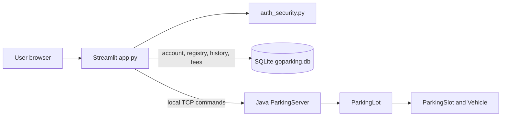
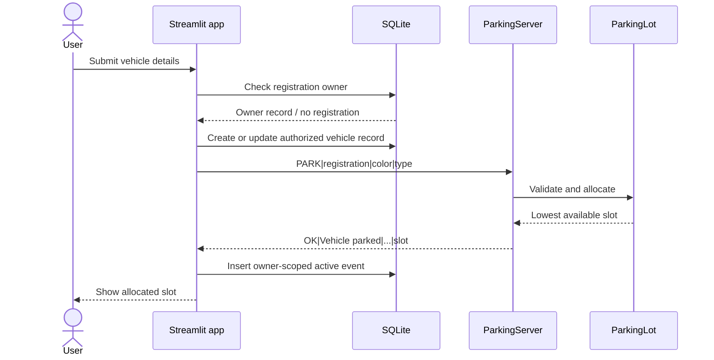
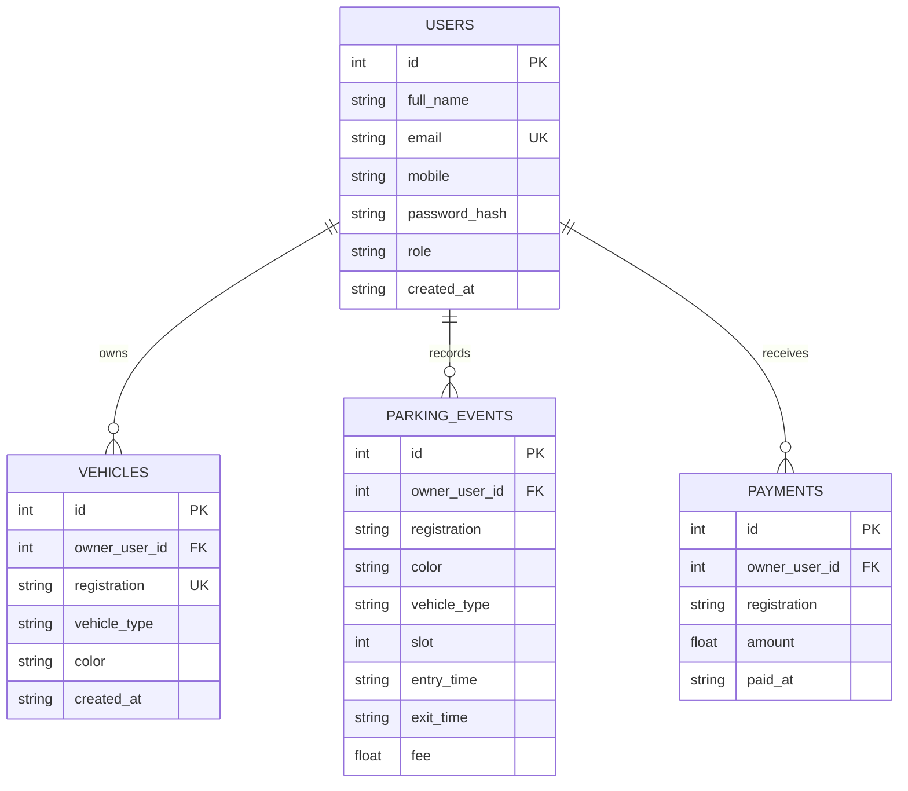
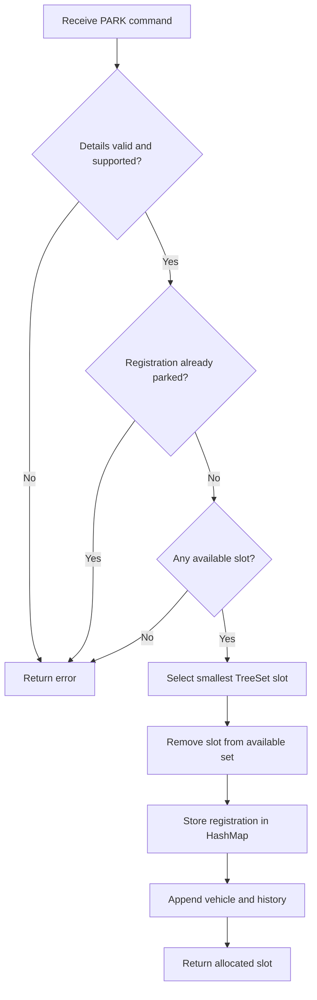

# GoParking Architecture and UML Diagrams

## Component architecture

The app database and Java in-memory allocation state are separate stores.
Restoration on startup is best effort; operations are not a distributed
transaction.

## Park vehicle sequence

## Account entity relationships

## Parking allocation activity

